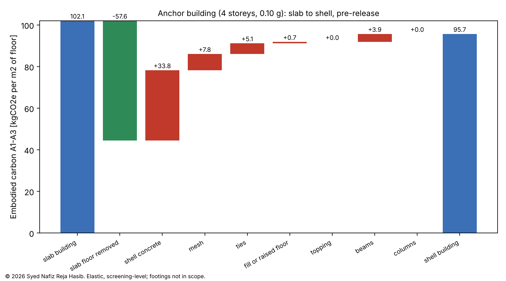
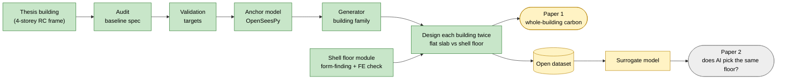

# ShellBench

[](https://github.com/syednafizreja/ShellBench/actions/workflows/tests.yml)


-orange)
[](https://doi.org/10.5281/zenodo.23851675)

**How much do thin-shell floors cut the whole-building A1–A3 embodied carbon of a GB 50010 / GB 50011 RC frame across 3–8 storeys, and how does the saving change with storey count and seismic intensity once diaphragm, tie and topping needs are met?**

(Revised 22 Oct 2026; see [docs/research_question.md](docs/research_question.md).)

A thinner floor weighs less. Less weight means smaller seismic forces, which can mean smaller beams, columns and footings. ShellBench follows that chain through the whole building, using real design codes, rather than comparing floors on their own.

> **Status (13 Nov 2026, Day 47).** All four hypotheses are decided (preregistration section 3). H1 partly supported, H2 not supported, H3 not supported (v0.4.0 files). H4 partly supported: the frozen surrogate ran once on the published data (error ratio 2.27 holds; conformal coverage 73.3 % on unseen storey counts fails; decision agreement 93.9 % holds, below the 97.0 % of always choosing the shell). The anchor, the generator, the shell floor module, both building families and the surrogate pipeline are built and checked. The anchor-comparison numbers below are from the v0.4.0 files. The dataset package for v0.4.0 is built (`scripts/make_dataset.py`, [docs/dataset_release.md](docs/dataset_release.md)); it is published on Zenodo (13 Nov 2026, CC BY 4.0) as [10.5281/zenodo.24194144](https://doi.org/10.5281/zenodo.24194144). Family files are final at version 0.4.0. Daily progress is in [LOG.md](LOG.md); the handover between work sessions is in [docs/handoff.md](docs/handoff.md).

### Validation at a glance

Differences between the model and the reference, as reported in [docs/anchor_report.md](docs/anchor_report.md) and `results/benchmarks_convergence.csv`. Large thesis differences are mostly errors in the thesis itself, each with a flag (D1–D29); the report gives the reason for every difference above 10 %.

| Check | Reference | Result | Within 10 %? |
|---|---|---|---|
| Frame, dead load (40 targets) | Thesis tables | median difference 4.2 %; 11 targets above 10 % | Most; reasons in report 4.1 |
| Frame, live load (40 targets) | Thesis tables | median difference 28.5 %; 26 above 10 % | No: thesis tables do not balance (D18, D19) |
| Frame, 1.3 D + 1.5 L (40 targets) | Thesis tables | median difference 10.7 %; 21 above 10 % | About half |
| Seismic base shear, bare frame | Thesis Table 8-12 | 214.75 against 264.77 kN, −18.9 % | No: thesis prints no period or weights (D24) |
| Wind storey drift | Thesis Table 8-2 | −45 % to −87 % | No: thesis drifts cannot come from one frame (D22) |
| Shell FE, Scordelis-Lo roof | MacNeal and Harder (1985) | 0.9984 of reference | Yes (−0.16 %) |
| Shell FE, pinched hemisphere | MacNeal and Harder (1985) | 0.9965 of reference | Yes (−0.35 %) |

| Area | State |
|---|---|
| Thesis audit and validation targets | Done. 16 thesis inconsistencies (B1–B16) each have a recorded decision ([docs/baseline_spec.md](docs/baseline_spec.md)). |
| Anchor frame (OpenSeesPy) | Done; released as [v0.1.0](https://github.com/syednafizreja/ShellBench/releases/tag/v0.1.0) on 1 Nov with DOI [10.5281/zenodo.23851676](https://doi.org/10.5281/zenodo.23851676). Gravity, wind, GB 50011 base shear, a 3D response-spectrum check, code checks, take-off and A1–A3 carbon. Every difference above 10 % from the thesis has a written reason ([docs/anchor_report.md](docs/anchor_report.md), [docs/anchor_notes.md](docs/anchor_notes.md)). |
| Hypotheses H1–H4 | Analysis plan approved by the author on 3 Nov, before any family row ([docs/preregistration.md](docs/preregistration.md)). Changes since then are in its change log. |
| Generator and conventional family | Done (tag v0.2.0, 6 Nov). The generator designs a frame to [docs/design_rules.md](docs/design_rules.md) (R3–R16, including capacity design). Family: 36 buildings, 3–8 storeys × six PGAs (0.05–0.40 g). 33 ok, 2 outside the code (above the 24 m limit), 1 failed to converge (grade I, 0.40 g); failures are counted, not dropped. |
| Shell floor module | Done (tag v0.3.0, 8 Nov). CalculiX S8R benchmarks within 0.4 % (Scordelis-Lo roof 0.9984, pinched hemisphere 0.9965). One sized panel, then a floor library of 72 cases ([docs/floor_library.md](docs/floor_library.md)). Diaphragm test (in-plane deflection ≤ 2 × storey drift) and topping rule ([docs/floor_concept.md](docs/floor_concept.md)). |
| Shell family | Run 8 Nov: 36 buildings × 36 floor variants × 4 toppings = 5,184 rows; 4,856 ok, 288 outside the code, 40 failed. Every ok row passes the diaphragm test, with no topping needed (worst ratio 0.0113). Family checks (IDs, failures, sums, three hand-checked pairs) in results/day31_checks.csv. |
| Anchor headline | The 4-storey, 0.10 g building: floor carbon 57.6 → 47.4 kgCO2e/m² (S_f 17.8 %), whole building 102.1 → 95.7 kgCO2e/m² (S_b 6.2 %). See the figure below. |
| Surrogate (Paper 2) | Built and frozen at commit 5c11ce8 (approved 9 Nov): random and leave-one-storey-count-out splits, three models, split-conformal intervals, leakage and decision tests ([docs/surrogate_notes.md](docs/surrogate_notes.md)). Run once on the published data (13 Nov 2026): H4 partly supported. Conformal coverage 0.733 on unseen storey counts (target 0.88–0.92); decision agreement 93.9 %, below the 97.0 % of always choosing the shell. Reported as found. |
| Paper 1 | Methods skeleton, numbers file and references in [paper/paper1/](paper/paper1/). |
| Figures | One house style for every figure and output ([docs/visual_standard.md](docs/visual_standard.md)); `python -m shellbench.figures` redraws them all from results/. |
| Tests | pytest: 261 passed (13 Nov 2026). |
| Open | The author confirms GB/T 1499.2 Table 2 and ASCE/SEI 7-16 cl. 12.3.1.3 in their own copies (checked by the AI assistant from open sources). H1–H4 are decided; the author checks them in the 14–17 Nov window. |



*Anchor building (4 storeys, 0.10 g), slab floor against the preregistered shell variant, step by step in kgCO2e/m² of floor area. One building; pre-release data from results/anchor_waterfall.csv.*

Plan: the build ends 13 Nov, the author checks 14–17 Nov, v1.0 follows on 17 Nov, and Paper 1 is submitted by 22 Nov.

---

## Approach

The study is checked against one real, fully documented building: the author's own thesis design. That building is validation case 0. Every model must reproduce it before it is trusted on anything else. The result is the generator, the building family and the floor interface, which anyone can run on their own building or floor (see [docs/impact_strategy.md](docs/impact_strategy.md)).



Green: done. Yellow: in progress. Grey: not started. "Done" for the family means run and checked on pre-release data; the dataset is published on 11 Nov.

1. **Anchor.** Rebuild the thesis building in code (gravity, wind, earthquake), add the code checks and the embodied-carbon count, and match the thesis results.
2. **Generator.** Write code that designs a building the way the thesis did, prove it on the thesis sizes, then use it to produce a family of buildings.
3. **Shell floor.** Form-find a vaulted floor panel, check it with a benchmarked shell finite-element solver, and size it for thickness, ties and buckling.
4. **Comparison.** Design every building in the family twice, once with a flat slab and once with a shell floor, and explain the saving term by term.
5. **Surrogate.** Train a fast model on the family and test whether it picks the same floor as the full design.

## Roadmap

Each week has a GitHub issue with its goals.

| Week | Dates (2026) | Goal | Release | Status |
|---|---|---|---|---|
| 1 | 19–25 Oct | [Audit the thesis and model it under gravity](https://github.com/syednafizreja/ShellBench/issues/1) | v0.0.1 | Done |
| 2 | 26 Oct–1 Nov | [Finish the anchor: lateral loads, code checks, carbon](https://github.com/syednafizreja/ShellBench/issues/2) | v0.1.0 (1 Nov, DOI) | Done |
| 3 | 1–7 Nov | [The generator and the building family](https://github.com/syednafizreja/ShellBench/issues/3) | v0.2.0 (6 Nov, tag) | Done |
| 4 | 30 Oct–6 Nov (alongside week 3) | [The thin-shell floor module](https://github.com/syednafizreja/ShellBench/issues/4) | v0.3.0 (8 Nov, tag) | Done |
| 5 | 7–13 Nov | [Whole-building results](https://github.com/syednafizreja/ShellBench/issues/5) | v0.4 and dataset DOI (11 Nov) | In progress (both families run and checked) |
| 6 | 4–22 Nov | [Write and submit Paper 1](https://github.com/syednafizreja/ShellBench/issues/6) | submitted by 22 Nov | In progress (Methods skeleton) |
| 7 | 7–13 Nov | [The AI surrogate study](https://github.com/syednafizreja/ShellBench/issues/7) | v0.5 (13 Nov) | In progress (code frozen; H4 verdict on published data) |
| 8 | 17 Nov–13 Dec | [Paper 2 and the public package](https://github.com/syednafizreja/ShellBench/issues/8) | v1.0 (17 Nov) | Not started |

v0.2.0 and v0.3.0 are plain tags with no GitHub release and no DOI, because each release mints a DOI and only final files are released.

Dates moved on 28 Oct 2026 with the author's approval: the build ends 13 Nov, 14-17 Nov is the author's check window, and no check is dropped. The day-by-day map is [docs/schedule.md](docs/schedule.md).

The hypotheses (H1–H4) and their analysis plan were approved and committed on 3 Nov 2026, before any family row existed ([docs/preregistration.md](docs/preregistration.md)).

Reuse items built into the weeks above (details in [docs/impact_strategy.md](docs/impact_strategy.md)): carbon factors as data files and a Zenodo DOI for every release from v0.1 (Week 2); buildings defined as data, not code (Week 3); a written floor plug-in contract with a conformance test (Week 4); reference problems and a datasheet in the dataset (Week 5); one-command reproduction of each paper's figures (Weeks 6 and 8); JOSS-ready documentation and two tutorials in v1.0 (Week 8).

## Done so far

| Item | What it holds |
|---|---|
| [docs/baseline_spec.md](docs/baseline_spec.md) | Every model input for the thesis building, each with its thesis section or table. 16 inconsistencies found in the thesis (B1–B16), each with the author's decision and reason. |
| [validation/thesis_values/](validation/thesis_values/) | Eight CSV files of thesis results: beam-end moments, column axial forces, D-values, wind drift, seismic storey shear and drift, beam steel, the full live-load distribution table and the roof rows of the combination table. Every row names its source table. Flags D1–D21 mark values that look wrong; they are left as printed. |
| [tests/](tests/) | Checks that every validation file has units in its headers, no empty cells and numbers where numbers belong; closed-form and equilibrium tests of the anchor frame. |
| [src/shellbench/anchor_frame.py](src/shellbench/anchor_frame.py) | The thesis transverse frame as a 2D elastic OpenSeesPy model, loaded with dead and live load the way the thesis distributes them. |
| [src/shellbench/combinations.py](src/shellbench/combinations.py) | The thesis load combinations as data (1.3D + 1.5L now; wind and seismic ones wait for their load cases). |
| [src/shellbench/thesis_checks.py](src/shellbench/thesis_checks.py) | Arithmetic checks on the thesis tables: column sums and joint balance of the live-load moment distribution, factors of the combination table. |
| [results/](results/) | Anchor comparisons with the thesis and the thesis-table checks; the conventional and shell family files (CSV and parquet); the floor and diaphragm libraries; the anchor slab-against-shell comparison; family checks; surrogate accuracy, coverage, leakage and decision files. Causes of every anchor difference above 10 % in [docs/anchor_notes.md](docs/anchor_notes.md). |
| [docs/gap_matrix.md](docs/gap_matrix.md) | 23 papers from 2020-2026, each with what it studied, whether seismic loads and ties were included, and a section locator; gap statements G1-G4. Sources in [docs/reading_list.md](docs/reading_list.md), all legal open copies. |
| [docs/goal_stress_test.md](docs/goal_stress_test.md) | Red-team review of the research question (holes H1-H9) and the fixes adopted. |
| [docs/week01_review.md](docs/week01_review.md) | Week 1 review: every Done-when line checked against a file, and the weak points to handle before the anchor report. |
| [notes/gb50011_base_shear_primer.md](notes/gb50011_base_shear_primer.md) | Study note on the GB 50011 base-shear method worked on the thesis building, with the clauses to check before Day 9. |
| [docs/impact_strategy.md](docs/impact_strategy.md) | How others will reuse and cite ShellBench: what the charter already covers, additions A1-A10 placed in Weeks 2-8 without moving a date, and ideas parked under Later. |
| [docs/floor_concept.md](docs/floor_concept.md) | The approved shell floor concept (layout A), levelling options and the f/L range 1/8 to 1/20. |
| [src/shellbench/](src/shellbench/) | Also holds the wind, seismic, response-spectrum, 3D anchor, design-check, carbon and CalculiX modules; the generator, capacity design and batch runner; the shell floor (form-finding, shell FE, panel, floor library, diaphragm); family checks; the house style and figures; and the surrogate in `ml/`. Each has tests. |
| [docs/q1_standards.md](docs/q1_standards.md) | Journal and publication-ethics rules (Elsevier, Springer Nature, COPE) that the project follows every day, with a daily compliance check. |
| [docs/anchor_report.md](docs/anchor_report.md) | The anchor report: the model against the thesis, load case by load case, with every difference explained. |
| [docs/design_rules.md](docs/design_rules.md) | The rules the generator designs to (R3–R16), each with its GB 50010 / GB 50011 clause. |
| [docs/preregistration.md](docs/preregistration.md) | Hypotheses H1–H4, the approved analysis plan (3 Nov) and its change log. |
| [docs/data_card.md](docs/data_card.md) | The frozen column format of the family files (family_rc and family_shell). |
| [docs/floor_library.md](docs/floor_library.md) | The 72 sized shell floor cases (span, f/L, levelling, mesh) and their spot checks. |
| [docs/pilot_hand_checks.md](docs/pilot_hand_checks.md) | Hand checks of three pilot buildings (s04-p010, s03-p030, s06-p040) against the generator, checked by the author on 5 Nov. |
| [docs/surrogate_notes.md](docs/surrogate_notes.md) | The surrogate study: splits, models, conformal intervals, leakage and decision tests, the freeze. |
| [docs/visual_standard.md](docs/visual_standard.md) | The house style and review checklist for every figure, README and card. |
| [docs/direction_review.md](docs/direction_review.md) | Direction review of 6 Nov (The AI assistant's judgement, adopted by the author as standing guidance): priorities P1–P5, Paper 1 as the flagship. |
| [docs/schedule.md](docs/schedule.md) | The day-by-day map to 17 Nov. |
| [paper/paper1/](paper/paper1/) | Paper 1 working files: core claim, Methods skeleton, numbers with their sources, references, review notes. |
| [scripts/reproduce.py](scripts/reproduce.py) | Rebuilds every result Paper 1 uses with one command, with provenance files; `--quick` for a self-test. |

## The anchor building

A four-storey cast-in-place RC moment-frame office building in Panzhihua, Sichuan, China, designed by the author as a 2023 thesis. Values below are from [docs/baseline_spec.md](docs/baseline_spec.md); the ID in brackets is the row there.

| Property | Value |
|---|---|
| Transverse spans | 7.2 m + 6.6 m + 7.2 m (G3) |
| Storey height | 3.6 m typical, 4.55 m ground storey (G6, G7) |
| Columns | 600 × 600 mm (M5) |
| Frame beams | 300 × 600 mm side spans, 300 × 500 mm corridor (M1, M2) |
| Slab | 120 mm (G10) |
| Materials | C40 concrete, HRB400 bars (X1, X5) |
| Seismic | Intensity 7 (0.10 g), group 1, site class II, Tg = 0.35 s, seismic grade three (S1–S5) |
| Design codes | Chinese codes GB 50009 (loads), GB 50010 (concrete), GB 50011 (seismic) |

The thesis is kept private and is not in this repository. Only the values typed from it are.

## Repository map

```
ShellBench/
├── src/shellbench/       Python package (anchor, generator, batch, shell floor, carbon, figures)
│   └── ml/               surrogate study (frozen at 5c11ce8)
├── tests/                pytest suite
├── docs/                 specifications, literature, charter and journal-rule notes
├── scripts/              reproduce.py, surrogate figures, pilot hand checks
├── validation/
│   ├── thesis_values/    thesis results as CSV validation targets, with flags
│   └── benchmarks.csv    shell FE benchmark problems and reference answers
├── data/                 input data (carbon factors)
├── results/              generated results (anchor, families, libraries, surrogate)
├── figures/              generated figures
├── paper/                manuscripts (Paper 1 working files)
├── notes/                working notes (GB 50010 and GB 50011 primers)
├── .github/workflows/    tests on every push and pull request; release workflow
├── .commands/     /sync and /today commands
├── LOG.md                daily research log
├── the project rules             rules for AI assistance
├── environment.yml       conda environment "research"
├── pyproject.toml        package and pytest configuration
├── CITATION.cff          citation metadata
└── .zenodo.json          Zenodo release metadata
```

## Getting started

Requires [conda](https://docs.conda.io/). The environment pins Python 3.12, which OpenSeesPy needs.

```bash
git clone https://github.com/syednafizreja/ShellBench.git
cd ShellBench
conda env create -f environment.yml
conda activate research
pip install -e .
pytest
python scripts/reproduce.py --quick   # self-test: tests + 2 buildings, a few minutes
python scripts/reproduce.py           # every result in results/ that Paper 1 uses
python -m shellbench.figures          # redraw every figure from results/
```

The environment includes OpenSeesPy (frame analysis), gmsh (meshing), CalculiX (shell finite elements), pyarrow (parquet files) and scikit-learn (surrogate), plus the usual numpy, scipy, pandas and matplotlib. Steps that need CalculiX (`ccx`) are skipped by the tests when it is not installed.

## Working rules

- **SI units everywhere.** Every CSV header states its unit, e.g. `M_end [kN*m]`.
- **Every number traces to a source:** a thesis section or table, a code clause, or the code in this repository.
- **Thesis errors are flagged, not fixed.** Values are typed as printed, and disputed ones are settled by a recorded decision.
- **Judgement is marked.** Anything that is reasoning rather than a sourced value carries `[J]`.

## Use of AI assistance

Code and documents in this repository are drafted with the AI assistant (Anthropic) and checked by the author. All engineering decisions are the author's. The rules the AI assistant works under are in [the project rules](the project rules).

## How to cite

Citation metadata is in [CITATION.cff](CITATION.cff); GitHub's "Cite this repository" button uses it. The repository is public, and Zenodo mints a DOI for each GitHub release, so only final files are released. To cite all versions, use the concept DOI [10.5281/zenodo.23851675](https://doi.org/10.5281/zenodo.23851675); v0.1.0 is [10.5281/zenodo.23851676](https://doi.org/10.5281/zenodo.23851676). The v0.4.0 dataset (building families, libraries, checks, carbon factors and data card) is a separate record: [10.5281/zenodo.24194144](https://doi.org/10.5281/zenodo.24194144).

## Author

Syed Nafiz Reja Hasib

## Licence

MIT. See [LICENSE](LICENSE).
