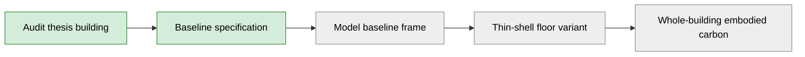
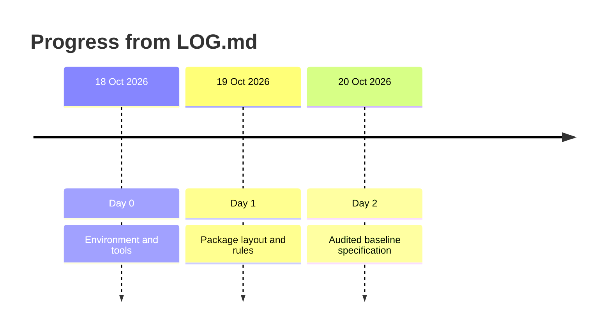

# ShellBench


Quantifying the whole-building embodied-carbon savings of thin-shell floors in code-designed reinforced-concrete (RC) frames in seismic zones.

## Research question

How much embodied carbon do thin-shell floors save in code-designed RC frames in seismic zones, once every knock-on effect is counted?

## Method overview

Source: [docs/baseline_spec.md](docs/baseline_spec.md), [LOG.md](LOG.md).

1. Audit the thesis building and fix a baseline specification.
2. Model the baseline frame (tools installed: OpenSeesPy, gmsh, CalculiX; see [LOG.md](LOG.md)).
3. Replace the floor with a thin-shell floor and redo the design.
4. Compare whole-building embodied carbon, including knock-on effects.

Steps 3 and 4 are planned. No modelling code or results are committed yet.



Green: done. Grey: not started, as far as committed files show.

## Progress

Source: [LOG.md](LOG.md).

| Day | Date | Done |
|---|---|---|
| 0 | 18 Oct 2026 | Environment `research` (Python 3.12) set up with the analysis tools |
| 1 | 19 Oct 2026 | Package layout, [CLAUDE.md](CLAUDE.md), README; pytest 2 passed |
| 2 | 20 Oct 2026 | [docs/baseline_spec.md](docs/baseline_spec.md): every model input with its source, and 16 inconsistencies (B1–B16), each with a decision and reason |



### Next

Items carried forward in [LOG.md](LOG.md) (Day 2) and still open:

- Confirm Tg used in alpha1 (B5).
- T1 and Gi to be computed by OpenSeesPy (B9).
- Spurious row 5 in the thesis table 8-12 (B4); wrong axial forces in table 9.3.
- Generator rounding rule for the 0.85 axial limit (B16).
- Walls in the carbon boundary (B15).

## Repository map

| Path | Content |
|---|---|
| [src/shellbench/](src/shellbench/) | Python package (version string only so far) |
| [tests/](tests/) | pytest suite (placeholder and import smoke test) |
| [docs/](docs/) | [baseline_spec.md](docs/baseline_spec.md) |
| `data/`, `results/`, `figures/`, `notes/`, `paper/` | Empty folders (`.gitkeep` only) |
| [pyproject.toml](pyproject.toml) | Package and pytest configuration |
| [environment.yml](environment.yml) | Conda environment `research` |
| [CLAUDE.md](CLAUDE.md) | Rules for AI assistance |
| [CITATION.cff](CITATION.cff) | Citation metadata |
| [LICENSE](LICENSE) | MIT licence |
| [LOG.md](LOG.md) | Research log |

## Installation

Create the conda environment `research` (Python 3.12) from [environment.yml](environment.yml), then install the package:

```bash
conda env create -f environment.yml
conda activate research
pip install -e .
```

## Running tests

From the repository root, with the `research` environment active:

```bash
pytest
```

## How to cite

Citation metadata is in [CITATION.cff](CITATION.cff). GitHub shows a "Cite this repository" button from it.

> Hasib, S. N. R. *ShellBench*. Quantifying the whole-building embodied-carbon savings of thin-shell floors in code-designed reinforced-concrete frames in seismic zones. MIT licence.

## Use of AI assistance

The code in this repository is written with Claude (Anthropic) and checked by the author. The rules Claude works under are in [CLAUDE.md](CLAUDE.md).

## Author

Syed Nafiz Reja Hasib

## Licence

Released under the MIT Licence. See [LICENSE](LICENSE).
