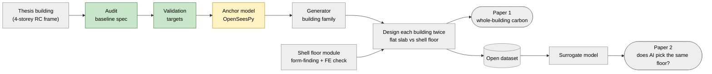

# ShellBench

[](https://github.com/syednafizreja/ShellBench/actions/workflows/tests.yml)


**How much do thin-shell floors cut the whole-building A1–A3 embodied carbon of a GB 50010 / GB 50011 RC frame across 3–8 storeys, and how does the saving change with storey count and seismic intensity once diaphragm, tie and topping needs are met?**

(Revised 22 Oct 2026; see [docs/research_question.md](docs/research_question.md).)

A thinner floor weighs less. Less weight means smaller seismic forces, which can mean smaller beams, columns and footings. ShellBench follows that chain through the whole building, using real design codes, rather than comparing floors on their own.

> **Status.** Week 1 of an 8-week plan. The thesis building has been audited and its published results typed in as validation targets. There is no analysis code or result yet. Daily progress is in [LOG.md](LOG.md).

---

## Approach

The study is built on one real, fully documented building: the author's own thesis design. Every model is checked against that building before it is trusted on anything else.



Green: done. Yellow: in progress. Grey: not started.

1. **Anchor.** Rebuild the thesis building in code (gravity, wind, earthquake), add the code checks and the embodied-carbon count, and match the thesis results.
2. **Generator.** Write code that designs a building the way the thesis did, prove it on the thesis sizes, then use it to produce a family of buildings.
3. **Shell floor.** Form-find a vaulted floor panel, check it with a benchmarked shell finite-element solver, and size it for thickness, ties and buckling.
4. **Comparison.** Design every building in the family twice, once with a flat slab and once with a shell floor, and explain the saving term by term.
5. **Surrogate.** Train a fast model on the family and test whether it picks the same floor as the full design.

## Roadmap

Each week has a GitHub issue with its goals.

| Week | Dates (2026) | Goal | Release | Status |
|---|---|---|---|---|
| 1 | 19–25 Oct | [Audit the thesis and model it under gravity](https://github.com/syednafizreja/ShellBench/issues/1) | | In progress |
| 2 | 26 Oct–1 Nov | [Finish the anchor: lateral loads, code checks, carbon](https://github.com/syednafizreja/ShellBench/issues/2) | v0.1 | |
| 3 | 2–8 Nov | [The generator and the building family](https://github.com/syednafizreja/ShellBench/issues/3) | v0.2 | |
| 4 | 9–15 Nov | [The thin-shell floor module](https://github.com/syednafizreja/ShellBench/issues/4) | v0.3 | |
| 5 | 16–22 Nov | [Whole-building results](https://github.com/syednafizreja/ShellBench/issues/5) | dataset | |
| 6 | 23–29 Nov | [Write and submit Paper 1](https://github.com/syednafizreja/ShellBench/issues/6) | preprint | |
| 7 | 30 Nov–6 Dec | [The AI surrogate study](https://github.com/syednafizreja/ShellBench/issues/7) | | |
| 8 | 7–13 Dec | [Paper 2 and the public package](https://github.com/syednafizreja/ShellBench/issues/8) | v1.0 | |

The hypotheses (H1–H4) will be frozen in public in Week 3, before any family result exists.

## Done so far

| Item | What it holds |
|---|---|
| [docs/baseline_spec.md](docs/baseline_spec.md) | Every model input for the thesis building, each with its thesis section or table. 16 inconsistencies found in the thesis (B1–B16), each with the author's decision and reason. |
| [validation/thesis_values/](validation/thesis_values/) | Six CSV files (95 rows) of thesis results: beam-end moments, column axial forces, D-values, wind drift, seismic storey shear and drift, beam steel. Every row names its source table. 12 flags (D1–D12) mark values that look wrong; they are left as printed. |
| [tests/](tests/) | Checks that every validation file has units in its headers, no empty cells and numbers where numbers belong. |
| [docs/gap_matrix.md](docs/gap_matrix.md) | 23 papers from 2020-2026, each with what it studied, whether seismic loads and ties were included, and a section locator; gap statements G1-G4. Sources in [docs/reading_list.md](docs/reading_list.md), all legal open copies. |
| [docs/goal_stress_test.md](docs/goal_stress_test.md) | Red-team review of the research question (holes H1-H9) and the fixes adopted. |
| [docs/q1_standards.md](docs/q1_standards.md) | Journal and publication-ethics rules (Elsevier, Springer Nature, COPE) that the project follows every day, with a daily compliance check. |

## The anchor building

A four-storey cast-in-place RC moment-frame office building in Panzhihua, Sichuan, China, designed by the author as a 2023 thesis. Values below are from [docs/baseline_spec.md](docs/baseline_spec.md); the ID in brackets is the row there.

| Property | Value |
|---|---|
| Transverse spans | 7.2 m + 6.6 m + 7.2 m (G3) |
| Storey height | 3.6 m typical, 4.55 m ground storey (G6, G7) |
| Columns | 600 × 600 mm (M5) |
| Frame beams | 300 × 600 mm side spans, 300 × 500 mm corridor (M1, M2) |
| Slab | 120 mm (G10) |
| Materials | C40 concrete, HRB400 bars (X1, X5) |
| Seismic | Intensity 7 (0.10 g), group 1, site class II, Tg = 0.35 s, seismic grade three (S1–S5) |
| Design codes | Chinese codes GB 50009 (loads), GB 50010 (concrete), GB 50011 (seismic) |

The thesis is kept private and is not in this repository. Only the values typed from it are.

## Repository map

```
ShellBench/
├── src/shellbench/       Python package (analysis and design code; version string only so far)
├── tests/                pytest suite
├── docs/                 specifications, literature, charter and journal-rule notes
├── validation/
│   └── thesis_values/    thesis results as CSV validation targets, with flags
├── data/                 input data (empty so far)
├── results/              generated results (empty so far)
├── figures/              generated figures (empty so far)
├── paper/                manuscripts (empty so far)
├── notes/                working notes (empty so far)
├── LOG.md                daily research log
├── CLAUDE.md             rules for AI assistance
├── environment.yml       conda environment "research"
├── pyproject.toml        package and pytest configuration
└── CITATION.cff          citation metadata
```

## Getting started

Requires [conda](https://docs.conda.io/). The environment pins Python 3.12, which OpenSeesPy needs.

```bash
git clone https://github.com/syednafizreja/ShellBench.git
cd ShellBench
conda env create -f environment.yml
conda activate research
pip install -e .
pytest
```

The environment includes OpenSeesPy (frame analysis), gmsh (meshing) and CalculiX (shell finite elements), plus the usual numpy, scipy, pandas and matplotlib.

## Working rules

- **SI units everywhere.** Every CSV header states its unit, e.g. `M_end [kN*m]`.
- **Every number traces to a source:** a thesis section or table, a code clause, or the code in this repository.
- **Thesis errors are flagged, not fixed.** Values are typed as printed, and disputed ones are settled by a recorded decision.
- **Judgement is marked.** Anything that is reasoning rather than a sourced value carries `[J]`.

## Use of AI assistance

Code and documents in this repository are drafted with Claude (Anthropic) and checked by the author. All engineering decisions are the author's. The rules Claude works under are in [CLAUDE.md](CLAUDE.md).

## How to cite

Citation metadata is in [CITATION.cff](CITATION.cff); GitHub's "Cite this repository" button uses it. A software DOI is planned for v1.0.

## Author

Syed Nafiz Reja Hasib

## Licence

MIT. See [LICENSE](LICENSE).
