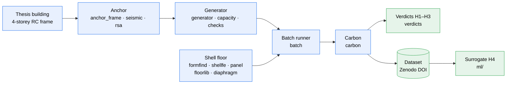

<div align="center">

# ShellBench

**Whole-building embodied carbon of thin-shell floors in GB-code reinforced-concrete frames**

[](https://github.com/syednafizreja/ShellBench/actions/workflows/tests.yml)
[](https://doi.org/10.5281/zenodo.23851675)
[](https://doi.org/10.5281/zenodo.24194144)


[Question](#the-question) ·
[Results](#results) ·
[Validation](#validation) ·
[Pipeline](#pipeline) ·
[Quick start](#quick-start) ·
[Repository layout](#repository-layout) ·
[How to cite](#how-to-cite)

</div>

---

## The question

> How much do thin-shell floors cut the whole-building A1–A3 embodied carbon of a GB 50010 / GB 50011 RC frame across 3–8 storeys, and how does the saving change with storey count and seismic intensity once diaphragm, tie and topping needs are met?

A thinner floor weighs less. Less weight means smaller seismic forces, which can mean smaller beams, columns and footings. ShellBench follows that chain through the whole building, using real design codes, rather than comparing floors on their own. The charter is [docs/research_question.md](docs/research_question.md).

**What is in the box**

| | |
|---|---|
| **Anchor** | A documented four-storey thesis building rebuilt under gravity, wind and earthquake; every difference above 10 % is explained. |
| **Generator** | Designs an RC moment frame to GB 50010 / GB 50011 rules R3–R16, including capacity design. |
| **Building family** | 36 conventional buildings (3–8 storeys × six PGAs, 0.05–0.40 g) and 5,184 shell-floor rows (36 floor variants × 4 toppings per building). |
| **Shell floor** | Force-density form-finding, CalculiX shell analysis, tie and buckling sizing, rigid-diaphragm test. |
| **Carbon** | A1–A3 embodied carbon from material take-off, with the factors as a data file. |
| **Verdicts** | Hypotheses H1–H4, preregistered on 3 Nov 2026 before any family row existed. |
| **Surrogate** | A frozen ML surrogate with split-conformal intervals, run once on the published data. |

## Results


*Whole-building saving S_b against floor-level saving S_f, one point per code-compliant building (33). Data: `results/verdicts_buildings.csv`.*

| Hypothesis | Verdict | Key numbers |
|---|---|---|
| **H1** whole-building saving | Partly supported | S_b > 0 in 32 of 33 buildings; median 5.66 % (min −0.33 %, max 30.68 %); 27 of 33 below S_f |
| **H2** | Not supported | [docs/preregistration.md](docs/preregistration.md) section 3 |
| **H3** | Not supported | [docs/preregistration.md](docs/preregistration.md) section 3 |
| **H4** surrogate | Partly supported | Error ratio 2.27 (holds); conformal coverage 73.3 % on unseen storey counts (fails); decision agreement 93.9 %, below the 97.0 % of always choosing the shell |

Every number is traced in [paper/paper1/numbers.md](paper/paper1/numbers.md). The verdicts are frozen and reported as found. Sensitivity: multiplying the lateral-system carbon by the plan-to-strip factor 1.3125 moves the H1 median to 4.13 % and leaves the verdict unchanged (`scripts/strip_factor_bound.py`).


*Anchor building (4 storeys, 0.10 g): floor carbon 57.6 → 47.4 kgCO2e/m² (S_f 17.8 %), whole building 102.1 → 95.7 kgCO2e/m² (S_b 6.2 %). Data: `results/anchor_waterfall.csv`.*

## Validation

Differences between the model and the reference, as reported in [docs/anchor_report.md](docs/anchor_report.md) and `results/benchmarks_convergence.csv`. Large thesis differences are mostly errors in the thesis itself, each with a flag (D1–D29); the report gives the reason for every difference above 10 %.

| Check | Reference | Result | Within 10 %? |
|---|---|---|---|
| Frame, dead load (40 targets) | Thesis tables | median difference 4.2 %; 11 targets above 10 % | Most; reasons in report 4.1 |
| Frame, live load (40 targets) | Thesis tables | median difference 28.5 %; 26 above 10 % | No: thesis tables do not balance (D18, D19) |
| Frame, 1.3 D + 1.5 L (40 targets) | Thesis tables | median difference 10.7 %; 21 above 10 % | About half |
| Seismic base shear, bare frame | Thesis Table 8-12 | 214.75 against 264.77 kN, −18.9 % | No: thesis prints no period or weights (D24) |
| Wind storey drift | Thesis Table 8-2 | −45 % to −87 % | No: thesis drifts cannot come from one frame (D22) |
| Shell FE, Scordelis-Lo roof | MacNeal and Harder (1985) | 0.9984 of reference | Yes (−0.16 %) |
| Shell FE, pinched hemisphere | MacNeal and Harder (1985) | 0.9965 of reference | Yes (−0.35 %) |

Full reasoning: [docs/anchor_report.md](docs/anchor_report.md) and [docs/anchor_notes.md](docs/anchor_notes.md). Global equilibrium is asserted on every frame analysis and on every static shell run with nodal forces and no gravity.

## Pipeline



Module names are the files in [src/shellbench/](src/shellbench/).

## Quick start

Requires [conda](https://docs.conda.io/). The environment pins Python 3.12, which OpenSeesPy needs. CalculiX (`ccx`) is needed for the shell steps; tests that need it are skipped without it.

```bash
git clone https://github.com/syednafizreja/ShellBench.git
cd ShellBench
conda env create -f environment.yml
conda activate research
pip install -e .
pytest                                # 275 tests
python scripts/reproduce.py --quick   # self-test: tests + 2 buildings, a few minutes
python scripts/reproduce.py           # every result in results/ that Paper 1 uses
python -m shellbench.figures          # redraw every figure from results/
```

## Repository layout

```
ShellBench/
├── src/shellbench/     Python package: anchor, generator, batch, shell floor, carbon, verdicts, figures
│   └── ml/             surrogate study (frozen at 5c11ce8)
├── tests/              pytest suite
├── scripts/            reproduce.py, dataset build, surrogate figures, sensitivity check
├── data/               input data (carbon factors)
├── validation/         thesis results as CSV targets (with flags) and shell FE benchmarks
├── results/            generated results: anchor, families, libraries, verdicts, surrogate
├── figures/            generated figures (one house style)
├── docs/               specifications, design rules, preregistration, reports, data card
├── paper/              Paper 1 working files and traced numbers
└── notes/              code primers (GB 50010, GB 50011)
```

| Document | What it holds |
|---|---|
| [docs/baseline_spec.md](docs/baseline_spec.md) | Every input of the anchor building with its thesis source; 16 thesis inconsistencies, each with a decision |
| [docs/anchor_report.md](docs/anchor_report.md) | The model against the thesis, load case by load case |
| [docs/design_rules.md](docs/design_rules.md) | Generator rules R3–R16, each with its clause |
| [docs/floor_concept.md](docs/floor_concept.md) · [docs/floor_library.md](docs/floor_library.md) | Shell floor concept and the 72 sized floor cases |
| [docs/preregistration.md](docs/preregistration.md) | Hypotheses H1–H4, analysis plan, change log and verdicts |
| [docs/data_card.md](docs/data_card.md) · [docs/dataset_release.md](docs/dataset_release.md) | Column format of the family files and the dataset release record |
| [docs/surrogate_notes.md](docs/surrogate_notes.md) | Surrogate splits, models, conformal intervals and the freeze |
| [docs/gap_matrix.md](docs/gap_matrix.md) | 23 open-access papers (2020–2026) and gap statements G1–G4 |
| [docs/visual_standard.md](docs/visual_standard.md) | House style for figures |
| [LOG.md](LOG.md) | Daily research log with every decision |

## The anchor building

A four-storey cast-in-place RC moment-frame office building in Panzhihua, Sichuan, China, designed by the author as a 2023 thesis. Values are from [docs/baseline_spec.md](docs/baseline_spec.md); the ID in brackets is the row there.

| Property | Value |
|---|---|
| Transverse spans | 7.2 m + 6.6 m + 7.2 m (G3) |
| Storey height | 3.6 m typical, 4.55 m ground storey (G6, G7) |
| Columns | 600 × 600 mm (M5) |
| Frame beams | 300 × 600 mm side spans, 300 × 500 mm corridor (M1, M2) |
| Slab | 120 mm (G10) |
| Materials | C40 concrete, HRB400 bars (X1, X5) |
| Seismic | Intensity 7 (0.10 g), group 1, site class II, Tg = 0.35 s, seismic grade three (S1–S5) |
| Design codes | GB 50009 (loads), GB 50010 (concrete), GB 50011 (seismic) |

The thesis itself is private; only the values typed from it are here.

## Working rules

- **SI units everywhere.** Every CSV header states its unit, e.g. `M_end [kN*m]`.
- **Every number traces to a source:** a thesis section or table, a code clause, or the code in this repository.
- **Thesis errors are flagged, not fixed.** Values are typed as printed; disputed ones are settled by a recorded decision.
- **Judgement is marked.** Reasoning rather than a sourced value carries `[J]`.

## Scope

Screening-level, elastic, code-level analysis under the stated assumptions. No claim of seismic safety.

## Long-term use

What is archived, the pinned environment, and how to rerun or check the results if a solver disappears: [docs/long_term.md](docs/long_term.md). Machine-readable metadata: [CITATION.cff](CITATION.cff), [codemeta.json](codemeta.json).

## Use of AI assistance

See [docs/ai_use.md](docs/ai_use.md).

## How to cite

Citation metadata is in [CITATION.cff](CITATION.cff); GitHub's "Cite this repository" button uses it.

- **Software, all versions:** [10.5281/zenodo.23851675](https://doi.org/10.5281/zenodo.23851675)
- **Dataset v0.4.0** (building families, libraries, checks, carbon factors, data card; CC BY 4.0): [10.5281/zenodo.24194144](https://doi.org/10.5281/zenodo.24194144)

```bibtex
@software{hasib_shellbench,
  author = {Hasib, Syed Nafiz Reja},
  title  = {{ShellBench}: whole-building embodied carbon of thin-shell floors in GB-code reinforced-concrete frames},
  year   = {2026},
  doi    = {10.5281/zenodo.23851675},
  url    = {https://github.com/syednafizreja/ShellBench}
}
```

## Author and licence

Syed Nafiz Reja Hasib · [ORCID 0009-0002-7162-7890](https://orcid.org/0009-0002-7162-7890)

Code: MIT ([LICENSE](LICENSE)). Dataset: CC BY 4.0.
