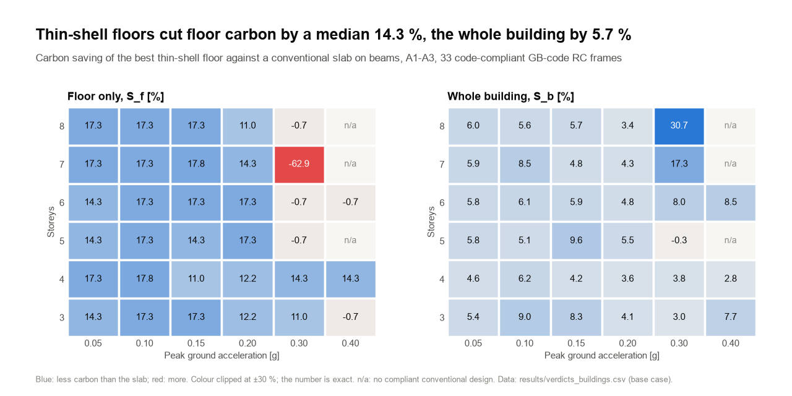
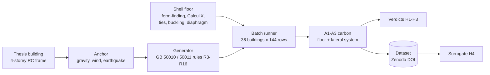
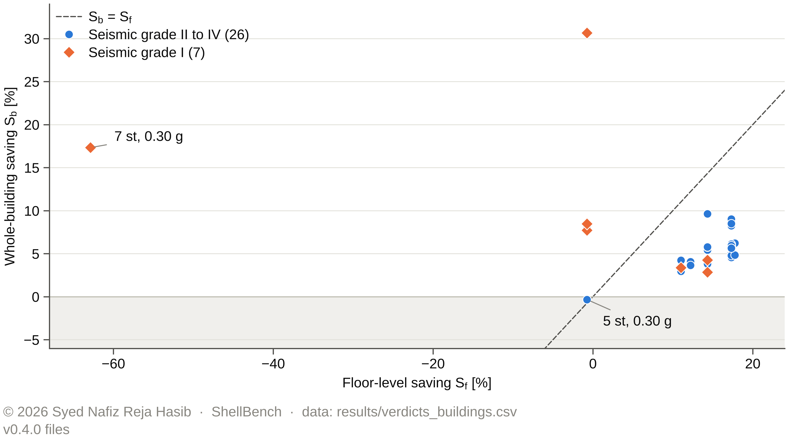
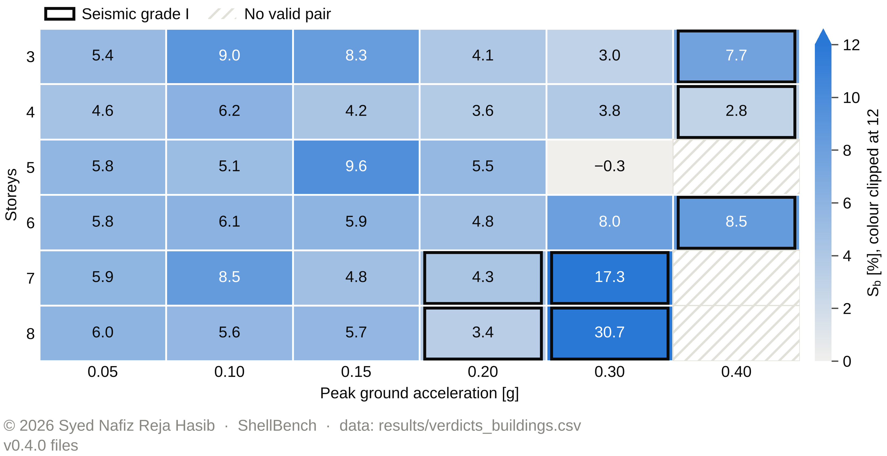
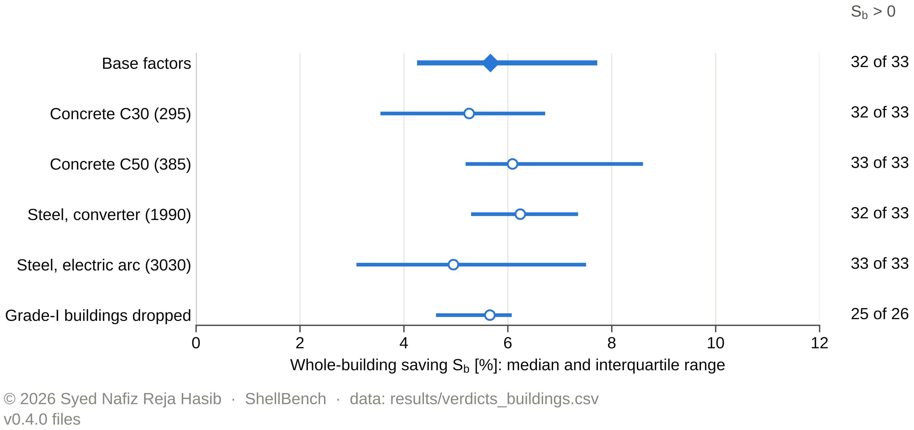
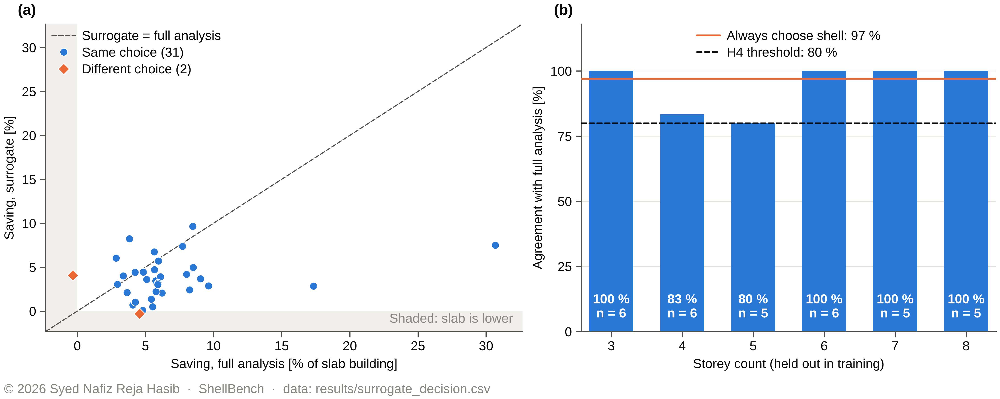

<h1 align="center">ShellBench</h1>

<p align="center"><b>Whole-building embodied carbon of thin-shell floors in GB-code reinforced-concrete frames</b><br>
A thin-shell floor saves concrete. Does the building save carbon once the frame, footings, diaphragm and topping are designed to code? 36 buildings, 5,184 shell-floor designs, pre-registered verdicts.</p>

<p align="center">
<a href="https://github.com/syednafizreja/ShellBench/actions/workflows/tests.yml"></a>
<a href="https://doi.org/10.5281/zenodo.23851675"></a>
<a href="https://doi.org/10.5281/zenodo.24194144"></a>
<a href="docs/preregistration.md"></a>

<a href="LICENSE"></a>
<a href="https://creativecommons.org/licenses/by/4.0/"></a>
</p>

<p align="center">
<a href="#key-finding">Key finding</a> ·
<a href="#method">Method</a> ·
<a href="#figures">Figures</a> ·
<a href="#validation">Validation</a> ·
<a href="#quick-start">Quick start</a> ·
<a href="docs/preregistration.md">Pre-registration</a> ·
<a href="#citation">Cite</a>
</p>

<picture>
  <source media="(prefers-color-scheme: dark)" srcset="docs/img/hero_dark.png">
  
</picture>

## The question

> How much do thin-shell floors cut the whole-building A1–A3 embodied carbon of a GB 50010 / GB 50011 RC frame across 3–8 storeys, and how does the saving change with storey count and seismic intensity once diaphragm, tie and topping needs are met?

A thinner floor weighs less. Less weight means smaller seismic forces, which can mean smaller beams, columns and footings. ShellBench follows that chain through the whole building under real design codes, rather than comparing floors on their own. The charter is [docs/research_question.md](docs/research_question.md).

## Key finding

> In **32 of 33** buildings the thin-shell floor lowers whole-building carbon, but by a median of **5.7 %**, against **14.3 %** for the floor alone.

The saving shrinks because the floor is only part of the building: the frame, footings and the rest stay. It does not grow with seismic intensity or storey count (H2), and no building needs a topping to act as a rigid diaphragm (H3). Every number and its source: [paper/paper1/numbers.md](paper/paper1/numbers.md).

| | |
|---|---|
| **Question** | Does a thin-shell floor cut whole-building carbon, and does the cut grow with PGA and storeys? |
| **Design space** | 6 storey counts (3–8) × 6 PGAs (0.05–0.40 g) = 36 buildings; 36 floor variants × 4 toppings = 144 shell rows per building, 5,184 in all |
| **Decision rule** | Pre-registered on 3 Nov 2026, before any family row existed ([section 2](docs/preregistration.md)) |
| **Record** | Frozen verdicts in `results/verdicts_*.csv`; checksums of every result in [`SHA256SUMS`](SHA256SUMS) |
| **Archive** | Software, all versions [10.5281/zenodo.23851675](https://doi.org/10.5281/zenodo.23851675); dataset [10.5281/zenodo.24194144](https://doi.org/10.5281/zenodo.24194144) |

| Hypothesis | Verdict | Key numbers |
|---|---|---|
| **H1** whole-building saving | Partly supported | S_b > 0 in 32 of 33 buildings; median 5.66 % (min −0.33 %, max 30.68 %); 27 of 33 below S_f |
| **H2** trend with PGA and storeys | Not supported | Positive, significant trend in 0 of 6 storey slices (PGA) and 1 of 6 PGA slices (storeys) |
| **H3** diaphragm and topping | Not supported | The untopped floor is rigid in all 33 buildings (0 of 1,180 untopped variants fail) |
| **H4** surrogate | Partly supported | Error ratio 2.27 (holds); conformal coverage 73.3 % on unseen storey counts (fails); decision agreement 93.9 %, below the 97.0 % of always choosing the shell |

The verdicts are frozen and reported as found ([docs/preregistration.md](docs/preregistration.md), section 3). No verdict changes under the five carbon-factor and grade-I sensitivity cases. Multiplying the lateral-system carbon by the plan-to-strip factor 1.3125 moves the H1 median to 4.13 % and leaves the verdict unchanged (`scripts/strip_factor_bound.py`).

## Method

Each building is designed twice: once with a flat RC slab and once with each thin-shell floor variant. Carbon is counted per m² of floor plan, A1–A3, from the material take-off:

$$
C \;=\; \underbrace{V_c\,e_c + m_s\,e_s + C_\text{fill}}_{\text{floor}} \;+\; \underbrace{V_c\,e_c + m_s\,e_s}_{\text{lateral system}},
\qquad
S_f = 1 - \frac{C_\text{floor}^\text{shell}}{C_\text{floor}^\text{slab}},
\qquad
S_b = 1 - \frac{C^\text{shell}}{C^\text{slab}}
$$

$V_c$ is the concrete volume, $m_s$ the steel mass, $e_c$ and $e_s$ their GB/T 51366-2019 carbon factors (`data/`), and $C_\text{fill}$ the fill over the shell. For each building, the shell is the lowest-carbon variant that passes every check and acts as a rigid diaphragm ([src/shellbench/verdicts.py](src/shellbench/verdicts.py)).



Module names are the files in [src/shellbench/](src/shellbench/): `anchor_frame`, `seismic`, `rsa` (anchor); `generator`, `capacity`, `checks` (generator); `formfind`, `shellfe`, `panel`, `floorlib`, `diaphragm` (shell floor); `batch`, `carbon`, `verdicts`; `ml/` (surrogate).

## Figures

Every figure is drawn from `results/` by script, as 600 dpi PNG, PDF and SVG, in one house style ([docs/visual_standard.md](docs/visual_standard.md)).

| Whole-building against floor saving (H1) | Saving against PGA and storeys (H2) |
|---|---|
|  |  |
| **Sensitivity of the verdicts** | **Surrogate decisions (H4)** |
|  |  |


*Anchor building (4 storeys, 0.10 g): floor carbon 57.6 → 47.4 kgCO2e/m² (S_f 17.8 %), whole building 102.1 → 95.7 kgCO2e/m² (S_b 6.2 %). Data: `results/anchor_waterfall.csv`.*

## Validation

Differences between the model and the reference, as reported in [docs/anchor_report.md](docs/anchor_report.md) and `results/benchmarks_convergence.csv`. Large thesis differences are mostly errors in the thesis itself, each with a flag (D1–D29); the report gives the reason for every difference above 10 %.

| Check | Reference | Result | Within 10 %? |
|---|---|---|---|
| Frame, dead load (40 targets) | Thesis tables | median difference 4.2 %; 11 targets above 10 % | Most; reasons in report 4.1 |
| Frame, live load (40 targets) | Thesis tables | median difference 28.5 %; 26 above 10 % | No: thesis tables do not balance (D18, D19) |
| Frame, 1.3 D + 1.5 L (40 targets) | Thesis tables | median difference 10.7 %; 21 above 10 % | About half |
| Seismic base shear, bare frame | Thesis Table 8-12 | 214.75 against 264.77 kN, −18.9 % | No: thesis prints no period or weights (D24) |
| Wind storey drift | Thesis Table 8-2 | −45 % to −87 % | No: thesis drifts cannot come from one frame (D22) |
| Shell FE, Scordelis-Lo roof | MacNeal and Harder (1985) | 0.9984 of reference | Yes (−0.16 %) |
| Shell FE, pinched hemisphere | MacNeal and Harder (1985) | 0.9965 of reference | Yes (−0.35 %) |

Global equilibrium is asserted on every frame analysis and on every static shell run with nodal forces and no gravity. The test suite (276 tests) runs on every push.

## Quick start

ShellBench needs [conda](https://docs.conda.io/) and Python 3.12 (OpenSeesPy needs it). CalculiX (`ccx`) is needed for the shell steps; tests that need it are skipped without it.

```bash
git clone https://github.com/syednafizreja/ShellBench.git
cd ShellBench
conda env create -f environment.yml
conda activate research
pip install -e .
pytest                                # 276 tests
```

Reproduce the study:

```bash
python scripts/reproduce.py --quick   # self-test: tests + 2 buildings, a few minutes
python scripts/reproduce.py           # every result in results/ that Paper 1 uses
python -m shellbench.figures          # redraw every figure from results/
python scripts/strip_factor_bound.py  # plan-to-strip sensitivity of H1
python scripts/readme_hero.py         # the matrices at the top of this page
```

**Long-term reproduction.** Exact versions are in [`environment.yml`](environment.yml) and [`environment.lock.yml`](environment.lock.yml), checksums of every result in [`SHA256SUMS`](SHA256SUMS) (`sha256sum -c SHA256SUMS` on a Linux or macOS clone), and [docs/long_term.md](docs/long_term.md) says how to use the results without running anything and what to do when a solver no longer installs.

## Repository layout

```text
ShellBench/
├── src/shellbench/        anchor, generator, batch runner, shell floor, carbon, verdicts, figures
│   └── ml/                surrogate study (frozen at 5c11ce8)
├── scripts/               reproduce.py, dataset build, sensitivity check, checksums, README matrices
├── tests/                 pytest suite, run in CI on every push
├── data/                  input data (carbon factors)
├── validation/            thesis results as CSV targets (with flags) and shell FE benchmarks
├── results/               the frozen record: anchor, families, libraries, verdicts, surrogate
├── figures/               figures as PNG, PDF and SVG, one house style
├── docs/                  specifications, design rules, pre-registration, reports, data card
├── paper/                 Paper 1 working files and the numbers-to-sources map
├── notes/                 code primers (GB 50010, GB 50011)
├── environment.lock.yml   exact software versions of the record
└── SHA256SUMS             checksums of every file in results/
```

| Document | What it holds |
|---|---|
| [docs/baseline_spec.md](docs/baseline_spec.md) | Every input of the anchor building with its thesis source; 16 thesis inconsistencies, each with a decision |
| [docs/anchor_report.md](docs/anchor_report.md) | The model against the thesis, load case by load case |
| [docs/design_rules.md](docs/design_rules.md) | Generator rules R3–R16, each with its clause |
| [docs/floor_concept.md](docs/floor_concept.md) · [docs/floor_library.md](docs/floor_library.md) | Shell floor concept and the 72 sized floor cases |
| [docs/preregistration.md](docs/preregistration.md) | Hypotheses H1–H4, analysis plan, change log and verdicts |
| [docs/data_card.md](docs/data_card.md) · [docs/dataset_release.md](docs/dataset_release.md) | Column format of the family files and the dataset release record |
| [docs/surrogate_notes.md](docs/surrogate_notes.md) | Surrogate splits, models, conformal intervals and the freeze |
| [docs/gap_matrix.md](docs/gap_matrix.md) | 23 open-access papers (2020–2026) and gap statements G1–G4 |
| [docs/long_term.md](docs/long_term.md) | Using the record in 10 or 20 years |
| [CHANGELOG.md](CHANGELOG.md) · [LOG.md](LOG.md) | Versions, and the daily research log with every decision |

## The anchor building

A four-storey cast-in-place RC moment-frame office building in Panzhihua, Sichuan, China, designed by the author as a 2023 thesis. Values are from [docs/baseline_spec.md](docs/baseline_spec.md); the ID in brackets is the row there.

| Property | Value |
|---|---|
| Transverse spans | 7.2 m + 6.6 m + 7.2 m (G3) |
| Storey height | 3.6 m typical, 4.55 m ground storey (G6, G7) |
| Columns | 600 × 600 mm (M5) |
| Frame beams | 300 × 600 mm side spans, 300 × 500 mm corridor (M1, M2) |
| Slab | 120 mm (G10) |
| Materials | C40 concrete, HRB400 bars (X1, X5) |
| Seismic | Intensity 7 (0.10 g), group 1, site class II, Tg = 0.35 s, seismic grade three (S1–S5) |
| Design codes | GB 50009 (loads), GB 50010 (concrete), GB 50011 (seismic) |

The thesis itself is private; only the values typed from it are here.

## Pre-registration and record

Hypotheses H1–H4, their thresholds and the analysis plan were fixed in [docs/preregistration.md](docs/preregistration.md) on 3 Nov 2026, before any family row existed. Every later decision is a dated entry in its change log. Rules for changes are in [CONTRIBUTING.md](CONTRIBUTING.md).

- **SI units everywhere.** Every CSV header states its unit, e.g. `M_end [kN*m]`.
- **Every number traces to a source:** a thesis section or table, a code clause, or the code in this repository.
- **Thesis errors are flagged, not fixed.** Values are typed as printed; disputed ones are settled by a recorded decision.
- **Judgement is marked.** Reasoning rather than a sourced value carries `[J]`.

**Scope.** Screening-level, elastic, code-level analysis under the stated assumptions. No claim of seismic safety.

**Used by.** [ShellForm](https://github.com/syednafizreja/ShellForm), a pre-registered study of the carbon cost of seismic resilience in form-found concrete shells, is built on ShellBench v0.3.0.

**Use of AI assistance.** See [docs/ai_use.md](docs/ai_use.md).

## Citation

If you use ShellBench, please cite the archived software (the concept DOI always resolves to the latest version) and, for the data, the dataset:

```bibtex
@software{hasib_shellbench,
  author    = {Hasib, Syed Nafiz Reja},
  title     = {{ShellBench}: whole-building embodied carbon of thin-shell floors in GB-code reinforced-concrete frames},
  publisher = {Zenodo},
  year      = {2026},
  doi       = {10.5281/zenodo.23851675},
  url       = {https://github.com/syednafizreja/ShellBench}
}
```

- **Dataset v0.4.0** (building families, libraries, checks, carbon factors, data card; CC BY 4.0): [10.5281/zenodo.24194144](https://doi.org/10.5281/zenodo.24194144)

Machine-readable metadata: [CITATION.cff](CITATION.cff) (GitHub's "Cite this repository" button) and [codemeta.json](codemeta.json).

## Author and licence

Syed Nafiz Reja Hasib · [ORCID 0009-0002-7162-7890](https://orcid.org/0009-0002-7162-7890)

Code: MIT ([LICENSE](LICENSE)). Dataset: CC BY 4.0.
